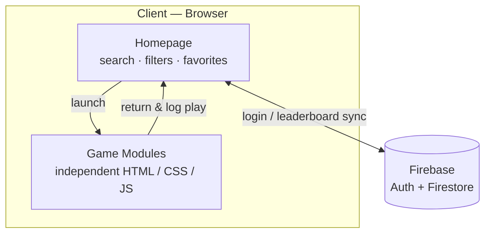
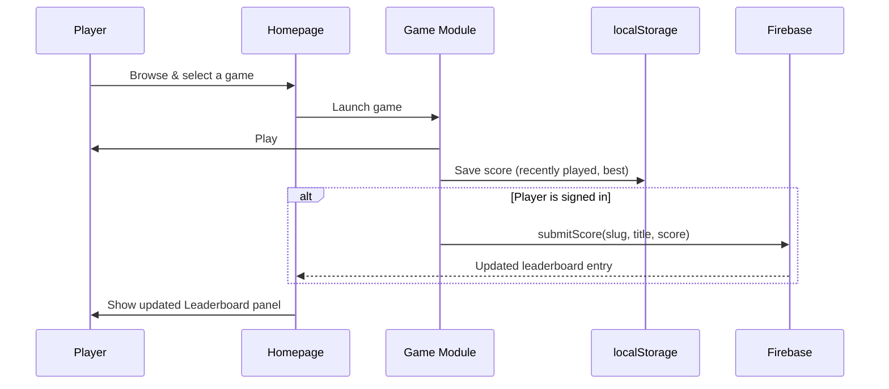

# 🕹️ Arcadia — Browser Game Portal

A static, no-build-step game hub that hosts independent HTML/CSS/JS games under one polished homepage — with search, favorites, an optional login system, and a cross-game leaderboard.

<p>
  
  
  
  
</p>

> 🔗 **Live demo:** _add your deployed URL here_

---

## 📋 Table of Contents

- [Features](#-features)
- [Games](#-games)
- [Tech Stack](#-tech-stack)
- [Architecture](#-architecture)
- [Core Workflow](#-core-workflow)
- [Project Structure](#-project-structure)
- [Getting Started](#-getting-started)
- [Adding a New Game](#-adding-a-new-game)
- [Login & Leaderboard Setup](#-login--leaderboard-setup)
- [Deployment](#-deployment)
- [Notes](#-notes)
- [Contributing](#-contributing)
- [License](#-license)

---

## ✨ Features

- **Curated game library** — searchable, filterable by category, with a featured rail and trending grid
- **Favorites & recently played** — persisted per-browser via `localStorage`, no account required
- **Light glassmorphism / Aurora UI** — a premium, VisionOS-inspired dashboard look
- **Plug-and-play games** — every game folder is untouched and independent; adding one is a 3-step process
- **Optional login** — email/password auth via Firebase; the whole site works fine without it
- **Cross-game leaderboard** — each signed-in player's single best score, tagged with the game it came from
- **Zero build step** — pure static HTML/CSS/JS, deployable anywhere in seconds

## 🎮 Games

| Game | Tagline | Players | Categories |
|---|---|---|---|
| Ping Pong | Classic 2-player table tennis | 2 (local) | Sports, Arcade |
| Balloon Blast | Pop, dodge & chase high scores | 1 | Arcade, Casual |
| Memory Card | Flip, match, remember | 1–2 | Puzzle, Casual |
| Cyber Tag | Neon arena chase | 1 | Action, Arcade |
| Candyland Tic-Tac-Toe | A sweeter spin on a classic | 1–2 | Puzzle, Strategy |
| Fruit Slash | Slice fast, dodge monsters | 1 | Arcade, Action |

## 🧱 Tech Stack

| Layer | Choice |
|---|---|
| Structure | Semantic HTML5, no framework |
| Styling | Vanilla CSS — design tokens + custom properties (`css/style.css`, `css/animations.css`) |
| Client logic | Vanilla JavaScript (`js/main.js`, `js/games-data.js`, `js/storage.js`) |
| Persistence (guest) | `localStorage` — favorites, recently played, theme |
| Auth | Firebase Authentication (Email/Password) |
| Database | Firebase Firestore |
| Hosting | Any static host — Netlify, GitHub Pages, Vercel, etc. |

## 🏗️ Architecture



Everything ships as static files. The only network call the site ever makes is to Firebase, and only for the login modal and the leaderboard panel — every game itself runs fully offline once loaded.

## 🔄 Core Workflow



## 📁 Project Structure

```
GameHub/
├── index.html                 → Homepage / game library
├── css/
│   ├── style.css              → Layout, theme tokens, components
│   └── animations.css         → Keyframes, page-transition, toast
├── js/
│   ├── games-data.js          → Game metadata (title, desc, category, thumbnail…)
│   ├── storage.js             → localStorage helpers (favorites, recently played, theme)
│   ├── main.js                → Rendering, search, filters, theme toggle, transitions
│   ├── firebase-config.js     → Your Firebase project keys (only file you edit)
│   ├── arcadia-cloud.js       → Auth + Firestore wrapper (window.Arcadia API)
│   └── auth-ui.js             → Login / sign-up modal
├── assets/
│   ├── icons/logo.svg
│   └── thumbnails/*.svg       → Card artwork for each game
└── games/
    ├── ping-pong/
    ├── balloon-blast/
    ├── memory-card/
    ├── cyber-tag/
    ├── tic-tac-toe-candyland/
    └── fruit-slash/
```

Each folder inside `games/` is **completely untouched and independent** — original HTML/CSS/JS/asset files, same filenames, same relative paths. The only change made inside a game folder is a small snippet appended before `</body>` that adds a floating **Home** + **Fullscreen** button and records the play in "Recently Played."

## 🚀 Getting Started

No build step, no dependencies to install.

```bash
git clone https://github.com/<your-username>/arcadia.git
cd arcadia/GameHub
python3 -m http.server 8000
```

Then open **http://localhost:8000**.

## ➕ Adding a New Game

1. Drop the game's folder into `games/<your-game-slug>/` (its own `index.html` must be the entry point).
2. Add one object to the `GAMES` array in `js/games-data.js` (title, description, categories, thumbnail path, accent color).
3. Optionally add an SVG/PNG thumbnail to `assets/thumbnails/`.

That's it — the homepage grid, search, and category filters pick it up automatically.

## 🔐 Login & Leaderboard Setup

The login system and cross-game leaderboard run on a free Firebase project (Authentication + Firestore) — it's the only backend the site uses, and it's entirely optional. Until it's configured, the Log In button shows a "not set up yet" message and the Leaderboard panel shows a friendly placeholder; everything else works normally.

Full step-by-step setup (project creation, Firestore security rules, and wiring a new game into it) is in **[`FIREBASE_SETUP.md`](./FIREBASE_SETUP.md)**.

## 🌐 Deployment

**Netlify** — drag-and-drop the `GameHub` folder, or connect the repo. No build command needed; publish directory is the project root.

**GitHub Pages** — push `GameHub`'s contents to the repo root (or `/docs`) and enable Pages on that branch/folder.

## 🗒️ Notes

- `games/balloon-blast/js/audio.js` references sound files under `assets/audio/` that aren't included in the repo — the game already fails silently (with a console warning) if they're missing. Drop matching `.mp3` files in that folder if you want sound.
- All thumbnails are hand-built SVGs (no external images), so they stay crisp at any size and add almost nothing to page weight.

## 🤝 Contributing

Contributions are welcome! To add a game, follow [Adding a New Game](#-adding-a-new-game) above and open a pull request. For bug fixes or UI improvements, feel free to open an issue first to discuss what you'd like to change.

## 📄 License

_Add your license here (e.g. MIT) — see `LICENSE` for details._
